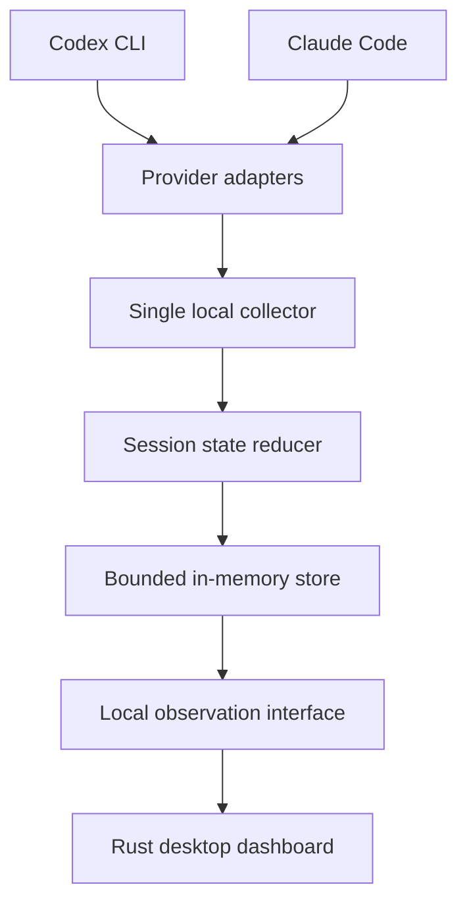

# Agent Monitor

**A local-first status dashboard for AI coding agents.**

See which coding agents are working, which need your attention, and which have finished their current turn, without switching between terminals. No physical Stream Deck, particular IDE, or project integration is required.

> Status: Phase 1 experiments completed. The maintainer approved a reduced Windows-first v0.1 implementation scope; the Phase 2 Rust collector is available for validation. See the [configuration and native API](docs/collector.md) and [Phase 2 validation results](docs/phase-2-validation.md). The [native Windows dashboard](docs/dashboard.md) subscribes to the collector. See the [approved MVP contract](docs/mvp.md), [Phase 1A/1B evidence](docs/phase-1-feasibility.md) and [Phase 1C evidence](docs/phase-1c-managed.md).

## MVP — approved scope

- **Codex managed, Windows, tested with CLI 0.167.0:** observe a dedicated private App Server shared by official Codex TUIs and a read-only Rust observer. Support sampled session/turn identity, active/idle, a single actual input wait and its clearance, completed and interrupted turns. Polling is not guaranteed to capture every transition.
- **Claude passive, Windows, tested with CLI 2.1.287:** ordinary session inventory and reported busy/idle only. No confirmed completion, input or approval notifications. Other versions remain unverified.
- **Codex passive:** ordinary launches remain untouched. Optional safe metadata discovery may be shown as limited/provisional; no full live state claim and no required monitor hooks.
- Display provider, observation mode, project label, status, confidence and observation age. Offer opt-in notifications only for newly observed, confirmed managed Codex input waits and turn completion, subject to production validation.
- One native Windows dashboard, a local Rust collector, no dedicated hardware, database, browser runtime, remote service or account for the monitor.

Managed mode is opt-in: users explicitly start a dedicated private owner and connect the official TUI using its supported remote mode. No automatic agent launcher, approval proxy or changes to ordinary launches. Approval wait/resolution, terminal failure, process exit, full Claude outcome/attention monitoring, native WSL2 providers and complete transition delivery are deferred. Existing WSL NAT transport tests do not establish native WSL agent support.

## Status model

| Status | Meaning when confirmed |
| --- | --- |
| RUNNING | The current turn is in progress |
| WAITING_APPROVAL | A human approval request is actually pending |
| WAITING_INPUT | A human input request is actually pending |
| COMPLETED | The current agent turn has finished normally |
| IDLE | A session is ready but has no active turn |
| ERROR | The current turn has explicitly failed |
| INTERRUPTED | The current turn has been interrupted |
| ENDED | The session has ended |
| UNKNOWN | The current state cannot be established |

A hook invocation is evidence, not necessarily a confirmed state transition. The monitor distinguishes confirmed, provisional, and unknown observations. Uncertain or stale observations must not appear as confirmed work, completion, or requests for attention. Completion means the agent turn ended, not that the requested implementation, tests, or deployment succeeded.

## Architecture

- Rust for all executable components, including the hook probe, relay, collector, tests, and future native desktop dashboard. Use Cargo and a small number of audited dependencies; no Node.js, JavaScript frontend, browser runtime, or Electron requirement.
- Provider adapters normalize only supported observations; the dashboard does not interpret raw provider payloads.
- One Windows-local collector. Use the approved local observation interfaces; no network or firewall changes. Native WSL provider support is deferred.
- In-memory session state only for v0.1; no database or durable session history.

## Non-goals for v0.1

Agent orchestration, automatic approvals, remote command execution, agent launch or termination, transcript collection, cloud services, multi-host synchronization, GitHub or CI integration, window activation, system tray or always-on-top widgets, and durable session history.

## Roadmap

1. **Feasibility (completed):** Phase 1A transport, Phase 1B passive observation and Phase 1C managed observation established the reduced Windows-first scope.
2. **Collector:** build the normalized reducer, local API, bounded store, and tests using verified evidence.
3. **Dashboard:** add live status, attention highlighting, and optional desktop notifications.
4. **v0.1 release:** safe installation/removal, documented manual managed setup, end-to-end verification, CI, and user documentation.
5. **Later releases:** desktop widgets, window switching, durable history, additional providers, and optional integrations.

## Design principles

Local-first · read-only monitoring · fail-open hooks · minimal dependencies · adapter-based · project-agnostic.

Monitoring must never control agent execution or approval decisions. A stopped, slow, or broken collector must not interfere with existing agent behavior. Prefer explicitly reporting uncertainty over guessing.

## Project language

English is the canonical language for repository documentation, issues, pull requests, commit messages, and user-facing interface text. Translations may be added later without replacing the English source of truth.

## Specification

See [docs/mvp.md](docs/mvp.md) for the feasibility gate, event and transport contracts, security requirements, and release acceptance criteria.

## License

Agent Monitor is released under the [MIT License](LICENSE) (SPDX: `MIT`). This license applies to the material published in this repository. Separately distributed future commercial extensions or hosted services may have their own terms.
