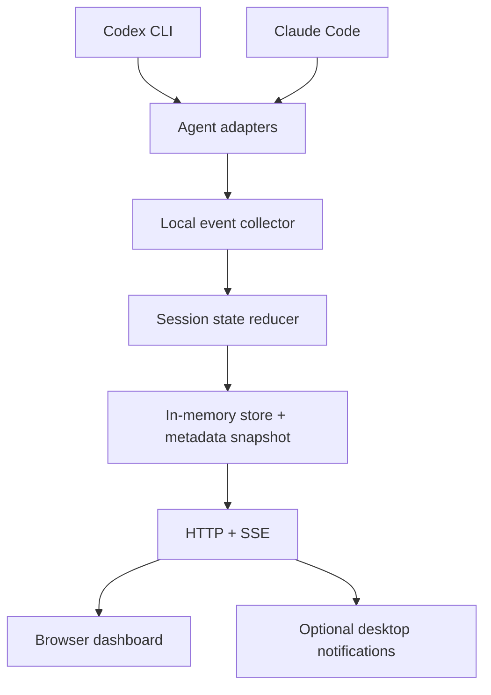

# Agent Monitor

**A local-first status dashboard for AI coding agents.**

Codex, Claude Code 등 여러 AI 코딩 에이전트의 작업 상태를 한 화면에서 확인하는 경량 로컬 관제 도구. 물리적 Stream Deck이나 특정 IDE, 특정 프로젝트에 의존하지 않는다.

> 상태: 초기 설계 초안 (v0.1). 아직 실행 가능한 구현은 제공하지 않는다.

## Why

여러 에이전트에게 작업을 병렬로 맡기면 어느 세션이 실행 중인지, 어떤 세션이 승인이나 입력을 기다리는지, 어느 작업이 끝났는지 확인하기 위해 수많은 창을 오가게 된다. Agent Monitor는 사람의 개입이 필요한 순간을 모아 보여준다.

## MVP

- Codex CLI와 Claude Code 세션을 공식 이벤트 또는 Hook으로 자동 등록·갱신한다.
- Windows 네이티브 및 WSL2에서 실행되는 세션을 한 대시보드에 표시한다.
- 세션별 에이전트, 프로젝트/작업 디렉터리, 상태, 마지막 이벤트 시각, 경과 시간을 표시한다.
- 입력 및 승인 대기 상태를 우선 노출하고 작업 완료 알림을 제공한다.
- 지원 가능한 경우 작업창으로 이동한다. 정확한 창 식별이 불가능하면 작업 디렉터리 복사 등 명시적인 대체 동작을 제공한다.
- 별도 하드웨어, 외부 서버, DB, 계정 가입 없이 로컬에서 동작한다.

## Status model

| 상태 | 의미 |
| --- | --- |
| RUNNING | 현재 요청 처리 중 |
| WAITING_APPROVAL | 사용자 권한 승인 요청이 확인됨 |
| WAITING_INPUT | 사용자 입력 요청이 확인됨 |
| COMPLETED | 현재 요청의 정상 완료 이벤트가 확인됨 |
| IDLE | 세션은 존재하지만 현재 처리 중인 요청이 없음 |
| ERROR | 명시적 오류가 확인됨 |
| INTERRUPTED | 사용자가 현재 요청을 중단함 |
| ENDED | 세션 종료가 확인됨 |
| UNKNOWN | 상태를 확정할 근거 부족 또는 수집 상태 불명 |

완료는 세션 종료와 구분한다. 도구 실행 완료는 요청 완료로 간주하지 않는다. 로그 정지나 경과 시간만으로 작업 완료·실패를 추정하지 않는다. 지원하지 않는 이벤트는 UNKNOWN 또는 마지막으로 확인된 상태와 수집 불확실성으로 표시한다.

## Architecture

- Node.js 22 이상, 내장 HTTP 서버, HTML/CSS/JavaScript, SSE, Node 내장 테스트 러너를 우선한다.
- 이벤트 어댑터가 에이전트별 차이를 정규화하며 대시보드는 특정 에이전트의 포맷을 직접 해석하지 않는다.
- 서버는 기본적으로 loopback만 수신한다. Windows와 WSL2 간 연결은 별도 환경 검증 후 문서화한다.
- 메모리 상태와 최소 메타데이터 스냅샷만 사용한다. DB나 프론트엔드 프레임워크 도입은 필요성이 입증될 때 결정한다.

## Non-goals (v0.1)

자동 권한 승인, 명령 원격 실행, 에이전트 자동 실행/종료, 전체 대화 기록 수집, 클라우드 서비스, GitHub API 및 CI/배포 상태 통합, 상용 Stream Deck 호환 플러그인, IDE 전용 확장.

## Roadmap

1. v0.1 — 이벤트 수집, 세션 상태, 실시간 웹 UI, Windows/WSL2 검증.
2. v0.2 — 시스템 트레이/상시 표시 위젯, 창 전환 개선, 알림 설정.
3. v0.3 — OpenCode 등 추가 어댑터, GitHub Issue/PR 메타데이터 연동(선택 사항).
4. v0.4 — 선택적 외부 CI/서비스 관측 및 모바일 접근. 기본 로컬 보안 모델 유지.

## Design principles

Local-first · read-only monitoring · fail-open hooks · minimal dependencies · adapter-based · project-agnostic.

수집기가 종료되거나 느려져도 본래 에이전트의 작업은 진행되어야 한다. 이벤트 전달 실패는 모니터 문제로 처리하며 권한 승인 또는 에이전트 실행을 변경하지 않는다.

구현 세부 명세와 인수 기준은 [docs/mvp.md](docs/mvp.md)를 참조한다.

## License

미정. 저장소 공개 상태와 별개로 라이선스 결정 전에는 임의로 오픈소스 라이선스를 부여하지 않는다.
