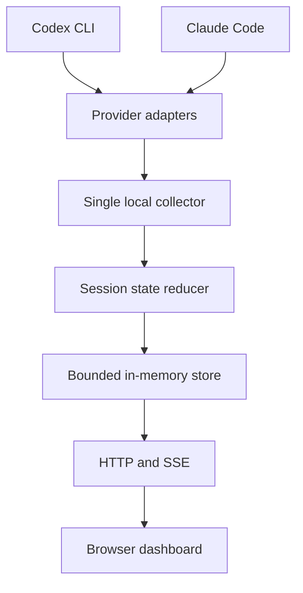

# Agent Monitor

**A local-first status dashboard for AI coding agents.**

See which coding agents are working, which need your attention, and which have finished their current turn, without switching between terminals. No physical Stream Deck, particular IDE, or project integration is required.

> Status: v0.1 design proposal. No runnable implementation or verified provider support is available yet.

## MVP

- Observe Codex CLI and Claude Code sessions through verified, supported observation interfaces.
- Show native Windows and WSL2 sessions in a single local dashboard, subject to the feasibility gate described in [the MVP specification](docs/mvp.md).
- Display the agent, project, session status, evidence confidence, and last observed time.
- Highlight confirmed requests for human attention; offer opt-in browser notifications for confirmed attention and completion transitions.
- Install and remove monitoring hooks safely, without changing existing agent behavior.
- Run without dedicated hardware, a database, an external service, or an account.

## Status model

| Status | Meaning when confirmed |
| --- | --- |
| RUNNING | The current turn is in progress |
| WAITING_APPROVAL | A human approval request is actually pending |
| WAITING_INPUT | A human input request is actually pending |
| COMPLETED | The current agent turn has finished normally |
| IDLE | A session is ready but has no active turn |
| ERROR | The current turn has explicitly failed |
| INTERRUPTED | The current turn has been interrupted |
| ENDED | The session has ended |
| UNKNOWN | The current state cannot be established |

A hook invocation is evidence, not necessarily a confirmed state transition. The monitor distinguishes confirmed, provisional, and unknown observations. Uncertain or stale observations must not appear as confirmed work, completion, or requests for attention. Completion means the agent turn ended, not that the requested implementation, tests, or deployment succeeded.

## Architecture

- Node.js 22 or later, built-in HTTP server and test runner, plain HTML/CSS/JavaScript, and server-sent events (SSE).
- Provider adapters normalize only supported observations; the dashboard does not interpret raw provider payloads.
- One loopback-only collector. Prefer a Windows-hosted collector with a verified local transport for WSL2; do not change network or firewall settings.
- In-memory session state only for v0.1; no database or durable session history.

## Non-goals for v0.1

Agent orchestration, automatic approvals, remote command execution, agent launch or termination, transcript collection, cloud services, multi-host synchronization, GitHub or CI integration, window activation, system tray or always-on-top widgets, and durable session history.

## Roadmap

1. **Feasibility spike:** establish real provider event semantics, safe hook behavior, and Windows/WSL2 connectivity before implementing the dashboard.
2. **Collector:** build the normalized reducer, local API, bounded store, and tests using verified evidence.
3. **Dashboard:** add live status, attention highlighting, and optional browser notifications.
4. **v0.1 release:** safe installation/removal, end-to-end verification, CI, and user documentation.
5. **Later releases:** desktop widgets, window switching, durable history, additional providers, and optional integrations.

## Design principles

Local-first · read-only monitoring · fail-open hooks · minimal dependencies · adapter-based · project-agnostic.

Monitoring must never control agent execution or approval decisions. A stopped, slow, or broken collector must not interfere with existing agent behavior. Prefer explicitly reporting uncertainty over guessing.

## Project language

English is the canonical language for repository documentation, issues, pull requests, commit messages, and user-facing interface text. Translations may be added later without replacing the English source of truth.

## Specification

See [docs/mvp.md](docs/mvp.md) for the feasibility gate, event and transport contracts, security requirements, and release acceptance criteria.

## License

Not yet selected. Public repository visibility does not constitute an open-source license. A license requires a separate maintainer decision before the project is presented as open source.
