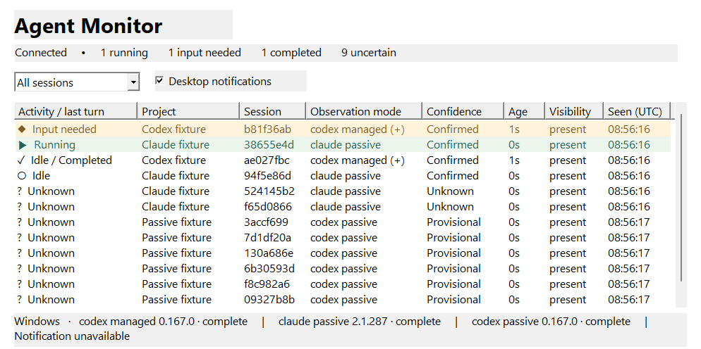
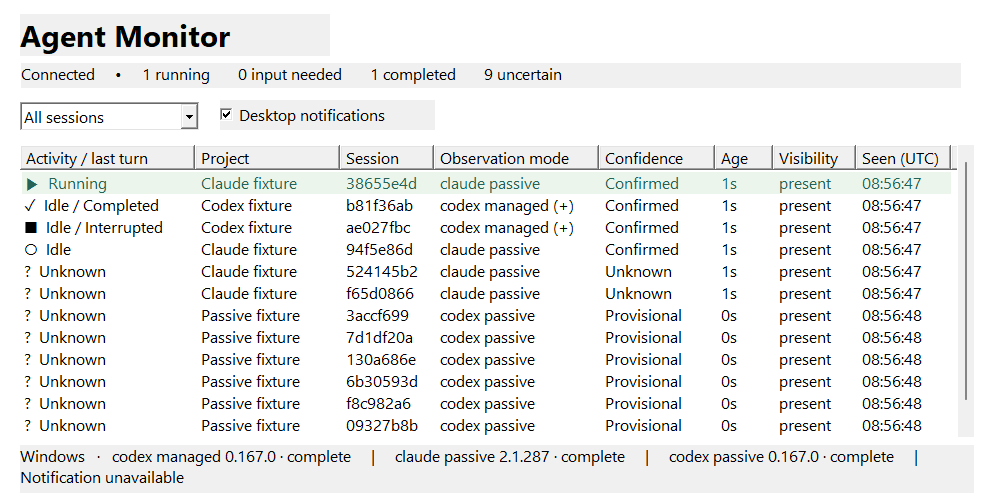
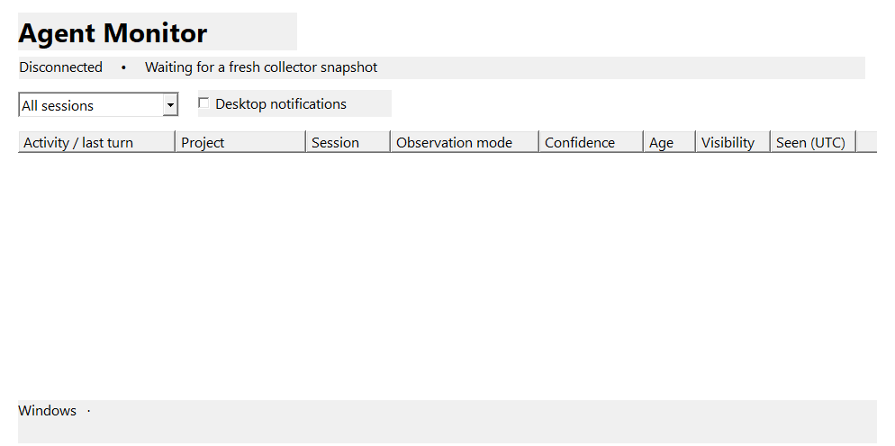
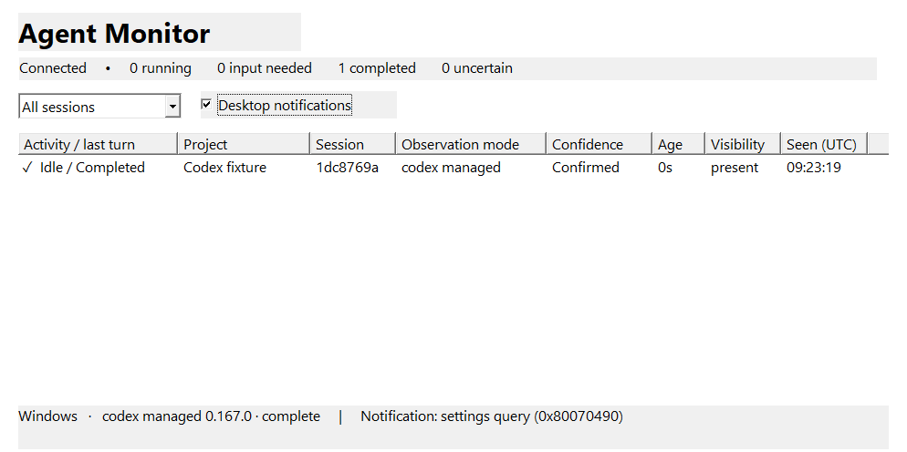

# Phase 3 dashboard validation

## Native Windows trial

Windows 10.0.26300, official Codex CLI 0.167.0, Claude Code 2.1.287. The collector executable was the previously validated Phase 2 Windows build at f30ed5d, included in merged main at 382eceb. The dashboard was the [CI-built Windows executable at 32a8789](https://github.com/changukshin/agent-monitor/actions/runs/45969202645), SHA-256 `9b00acee82a153c62e7df6cafc84e63a40ab2ddb5278a7cf2dcca82e9a3e02ab`. Subsequent changes added a socket regression test, rejected unknown visibility strings during decoding, and recorded the trial.

Two manually launched official TUIs shared a disposable private owner. Two ordinary Claude sessions used the supported executable. A third collector source supplied passive Codex inventory. An independent reader inspected the authenticated collector view. A Windows test harness read the dashboard's actual list-view cells and captured only the application window.

| Check | Actual result |
| --- | --- |
| Concurrent identities and grouping | Both active managed thread IDs were also discovered passively. Each appeared once, marked (+). The two verified Claude rows had separate session suffixes. Older provisional discoveries and uncertain Claude rows remained visible separately. |
| Input, clearance and completion | TUI A opened a two-choice input form. The dashboard displayed Input needed and counted one wait. After BETA was submitted, the same row returned to Running, then Idle / Completed. |
| Interruption | TUI B was sampled Running. Escape interrupted the turn. The dashboard displayed Idle / Interrupted without increasing the completion count. |
| Claude passive activity | One CLI retried a refused upstream model connection. It reported busy and appeared Running while the second Claude session remained Idle. The trial validates provider-reported activity only. |
| Native notifications | Enabled the checkbox and exercised a real eligible input wait. The Windows notification path returned unavailable, which appeared in the footer. The dashboard continued through clearance, interruption and completion. Banner delivery was not verified on this unpackaged host. No app identity, shortcut or notification setting was installed or changed. |
| Loss and recovery | Stopping the collector emptied the list and showed Disconnected. Restarting rotated its token. The same dashboard recovered automatically, showing Connected after 2,488 ms from collector process launch, including retry delay. |
| Non-interference | Closed the first dashboard normally and queried the still-running collector. Later force-killed only the dashboard and read another independent snapshot containing both managed outcomes and both Claude activities. Relaunch restored the same identities. |
| Footprint | The live release executable was 646,656 bytes. One four-client sample reported 28,897,280 bytes of process working set and 4,063,232 bytes of private memory. |

## Receipt-to-display measurements

For each changing row, the reader estimated collector receipt using poll start (Unix milliseconds) plus measured sample cost. The Windows harness timestamped first detection of the corresponding text in the native list control, polling approximately every 40 ms plus enumeration cost. Both clocks used the same host. These are accessibility-visible control updates; the test did not measure monitor scanout. Provider polling time precedes the baseline. Reconnect time includes backoff and is reported separately above.

| Transition | Milliseconds |
| --- | ---: |
| Codex A running | 308 |
| Claude running | 138 |
| Codex A input needed | 162 |
| Codex A running after input | 110 |
| Codex B running | 261 |
| Codex B interrupted | 176 |
| Codex A completed | 161 |

All seven sampled live updates met the one-second target. These measurements do not bound future latency or guarantee delivery of brief transitions.

## Automated validation

The dashboard tests exercise grouping, owner and instance boundaries, source precedence, attention ordering, summary counts and filters, passive scope, missing/stale/unsupported data and partial coverage. Subscription tests cover initial and replacement snapshots, revision replay, gap rejection, changed instances, disabled notifications, eligibility and same-turn re-entry after confirmed clearance. A native protocol fixture checks exact Host/Bearer, absent Origin, ping/pong and oversized-message rejection. Token fixtures check bounded reads and rotation. An injected failing notification sink verifies that denial leaves the subscriber usable. The full workspace includes the separate Phase 2 and spike suites.

The Windows target was cross-checked locally and the portable tests ran under WSL. Both CI runners execute the full locked workspace tests and release build. The Windows GUI and banner limitations above are live evidence independent of CI. Packaging and release approval remain outside this issue.

## Final notification review, 2026-11-27

Reviewed baseline: `108063e8beacc8f1bbfe7f665050ddb9db10c5d8`. The focused live trial used the [locked Windows release build](https://github.com/changukshin/agent-monitor/actions/runs/45972890641) from final implementation `e298ea50145450d6423ea8bf79828b10da816e5d`, executable SHA-256 `5f1c1dfcac33815a59f4ad6101d8d3c880bdbd2b84b5a6a10b04f832b36e1124`. Later edits add test cases, documentation and the capture only.

- **Native Windows GUI.** On Windows 10.0.26300 the dashboard subscribed to the Phase 2 collector and an official managed Codex 0.167.0 TUI. With notifications enabled, a real input form produced a confirmed Input needed row. The footer reported **settings query (0x80070490)**. This is HRESULT_FROM_WIN32(ERROR_NOT_FOUND). RoInitialize on the delivery thread and CreateToastNotifierWithId had both succeeded. Setting() returned an error before a policy value, XML construction or Show. The earlier boolean diagnostic alone could not establish that stage for the older build.
- **Identity evidence.** A read-only Get-StartApps lookup returned zero exact matches for AgentMonitor.Dashboard. Inspection of System.AppUserModel.ID on shortcuts under both current-user and common Start menu Programs folders also returned zero matches. The missing desktop identity is consistent with the lookup failure. Causality after registration remains for the packaged trial. No shortcut, identity or OS notification setting was changed.
- **Updates after failure.** The same connected native list row changed from Input needed to Running after BETA was submitted and then to Idle / Completed. The latest failure stage and HRESULT remained visible. The count of confirmed input waits fell to zero and completed rose to one.
- **Automated isolation.** A loopback WebSocket fixture deliberately blocks a fake OS sink, observes a newer running revision while the sink is still blocked, and checks that the cleared notification is obsolete before submission. The subscriber then accepts another revision after the sink reports an HRESULT failure or a disabled OS policy. Additional cases check queued expiry, same-turn clearance and re-entry, duplicate alerts and opt-out.
- **Outstanding release gate.** No visible Windows banner was demonstrated. Phase 4 must install and verify the shortcut identity and demonstrate visible native banner delivery under the [packaging acceptance procedure](dashboard.md#phase-4-packaging-and-banner-acceptance), unless explicitly excluded by the maintainer.

