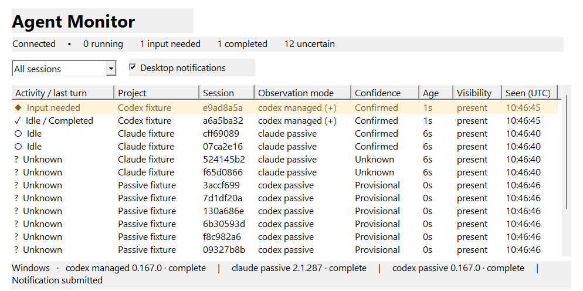
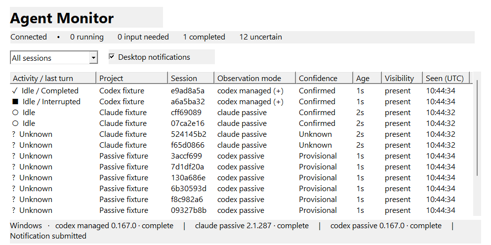
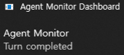

# Installed Windows v0.1.0 candidate validation

**Publication recommendation: NO-GO pending the clean-profile trial or explicit maintainer acceptance of the gap.** Both required banner types appeared on the target desktop. The decision applies to the immutable candidate below. Publication requires separate approval.

## Artifact and build

Source commit `5ba4b1aeba421850d475f8fe787d8a26d384f81d`, target `x86_64-pc-windows-msvc`, rustc 1.100.0 (0ef1bc386, LLVM 23.1.5). Windows and Ubuntu each passed 38 tests with `cargo test --workspace --locked --all-targets` and completed `cargo build --workspace --locked --release`. Windows also exercised the packaging and setup regression. The candidate was downloaded, checked against the supplied SHA-256 and installed as a standard user on Windows build 10.0.26300. [Candidate CI](https://github.com/changukshin/agent-monitor/actions/runs/45983855271) · [Candidate ZIP and checksum artifact](https://github.com/changukshin/agent-monitor/actions/runs/45983855271/artifacts/15190288237)

| File | SHA-256 |
| --- | --- |
| agent-monitor-0.1.0-windows-x64.zip | `0d8973144d4fcf5035d9ee2bf587d172c8838ddd0022da38a1730be9d47f08bc` |
| agent-monitor-collector.exe | `1863070b6520dd0c0546694f307fcf60325a8865d5bafd9a9f18cbd2025bf5ad` |
| agent-monitor-dashboard.exe | `c3b8c7c9c0a14120aded255c01e845d3578a3f001f852516e57d901aaf654522` |

ZIP 818,247 bytes. Extracted distribution 3,851,446 bytes in 13 files. Installed executable payload 1,678,848 bytes. At one live sample, working set/private bytes were 8,699,904/2,351,104 for the collector and 29,548,544/4,501,504 for the dashboard. These are snapshots, not peak bounds.

## Installed desktop observations

| Exercise | Result |
| --- | --- |
| Four ordinary clients | Two official Codex CLI 0.167.0 TUIs shared a private owner. Two Claude Code 2.1.287 clients ran concurrently. Claude showed idle and busy during an upstream connection retry, then idle. Successful Claude inference was not established. |
| Managed and passive views | The same two Codex threads appeared once each with the additional source marker. Confirmed counts reflected a waiting session and a completed session, then a completed session and an interrupted session. Provisional discovery and unknown activity stayed visibly distinct. |
| Real input and outcomes | A real form produced Input needed. Submitting BETA cleared the wait, followed by Running and Idle / Completed. Interrupting a running turn in the other TUI produced Idle / Interrupted. |
| Native banners | The operator directly witnessed the Windows **Input needed** banner. They did not see the completion banner on that first BETA turn. On a separate real completion, a desktop pixel capture showed the native **Turn completed** banner, with a corresponding collector alert and new Windows history entry. The dashboard status and notification history alone were not counted as visible banners. |
| Disabled and replay behavior | Disabling notifications before clearing another input wait allowed the completed state to appear without increasing the Windows notification counts. Reconnect and recovery produced no historical replay. Duplicate, stale and historical event filtering also has automated coverage. |
| Dashboard crash | Terminating the installed GUI left the collector and agent sessions available. Starting the GUI again from the registered shortcut restored the sessions. |
| Collector crash and token rotation | The dashboard showed disconnected with an empty view, then reconnected automatically in 3,488 ms including a deliberate one-second hold. The old bearer received HTTP 403. The replacement returned complete sources in 646 ms with no snapshot alerts. |
| Owner loss | Suspending the disposable owner produced a 6,015 ms timeout while the independent Claude source advanced twice. Resume recovered with zero alerts. After terminating the test owner, both Codex sources became unavailable and Claude remained complete. |

### Local display latency

Across 14 matched live state changes the native row appeared 121–375 ms after estimated collector receipt, including 185 and 200 ms for input waits. The observer matched session and state across the authenticated stream and native list control, polling the UI approximately every 40 ms. The receipt estimate uses source observation time plus sample cost. It excludes waiting for the next provider poll. Four rows already present when the observer attached were excluded. This sample meets the one-second local target and does not establish lossless transition delivery.

## Installation and diagnostics

The per-user shortcut resolved through Start to Agent Monitor Dashboard with AUMID `AgentMonitor.Dashboard`. Setup checked the actual target, working directory, arguments and identity. Upgrading the installed predecessor from `189767f` to the tested package preserved the operator configuration hash and stable shortcut. Two consecutive removals preserved configuration. A separate fresh install, repeat install and removal also succeeded. Final readback confirmed shortcut and tested application removal. The private API directory granted access to the current user, and graceful collector shutdown removed its credential. Locked binaries, edited shortcuts and preservation of unrelated files are exercised by the Windows setup regression.

Initial testing exposed incorrect receipt decoding under Windows PowerShell 5.1, ownership differences on the elevated CI runner and incorrect shortcut handling with a Unicode install path. Retries passed after explicit UTF-8 reads, explicit ownership for staged private files and native Unicode shell-link creation.

On the target desktop the registered predecessor still returned `0x80070490` from the WinRT notification setting lookup. A temporary app-specific identity metadata experiment did not resolve it and was removed. An independent diagnostic submission succeeded and Windows subsequently reported Enabled. The candidate allows initial submission on that specific missing-setting result. Explicitly disabled settings and other errors still suppress delivery. No global notification policy was changed. The absent-setting branch has automated coverage. The final candidate delivered both banner kinds on this user profile after the diagnostic had initialized it. A first-ever notification on a second untouched profile remains untested.

The evidence covers Windows x64 and the provider versions above. Ubuntu CI covers the locked workspace build and tests. Native WSL2 provider observation, full Claude turn outcomes, approvals and lossless delivery remain outside v0.1. The CI artifact is time-limited. Retain the reviewed ZIP and checksum together for the release decision.

## Final publication check (2026-11-27)

**First-ever notification: NOT RUN.** Windows reported one interactive console session, on the already-tested profile. The only other non-system profile directories belonged to the offline and online Codex sandbox accounts. Neither had a loaded profile or interactive desktop. The current process ran at medium integrity with a deny-only Administrators SID. No separate standard-user desktop with an authorized real Codex session was available. No account, notification history or global policy was changed. Installing to a different directory under the current user would reuse the same notification settings.

| Requested clean-profile observation | Result |
| --- | --- |
| Standard-user install, Start shortcut and AUMID readback | Untested on a clean profile |
| Initial setting and entry into the missing-setting fallback | Unobserved |
| First real input-wait and completed-turn desktop banners | Unobserved on a clean profile |
| Subsequent setting, continuing dashboard updates and agent behavior | Unobserved on a clean profile |

The earlier same-profile results above remain valid. They cannot establish cold initialization. To close the gap, sign into a separate standard-user desktop with authorized Codex access, verify the installed shortcut and its AUMID, and take a read-only initial settings reading. Enable dashboard notifications, trigger a real managed input wait, answer it, and observe completion. Record the setting HRESULT, evidence of the branch actually taken, both visible banners, resulting setting, dashboard transitions and normal TUI behavior. Do not prime the app with a diagnostic toast. If branch execution cannot be distinguished, record it as unobserved.

### Artifact custody and proposed publication procedure

The retained ZIP matched both the adjacent SHA-256 file and the digest above. Its embedded build manifest names the full candidate commit, and both executable hashes were independently recomputed from the archive and matched the manifest. A second verified copy of the ZIP and checksum was retained outside the checkout and CI retention lifecycle on the validation host. No merged-commit package was built or tested in this check.

1. After explicit maintainer approval, merge the PR using a merge commit that retains the tested source commit in main history. Record the merge SHA and validation-report permalink. Verify the tested commit is an ancestor and inspect the entire candidate-to-merge diff for changes to source, lockfile, packaging, workflow or packaged inputs.
2. To publish the exact reviewed bytes, after tag approval create the annotated v0.1.0 tag **on the full candidate source commit printed in the manifest**. Record the separate merge and validation-report SHAs in the annotation or release notes. Verify that the peeled tag equals the manifest commit. If project policy requires tagging the merge commit, follow the rebuild path below.
3. After publication approval, attach the preserved ZIP and checksum to the release for that tag. List the immutable source SHA, CI run, report permalink and expected ZIP digest in the release notes. Download the staged assets and recompute the ZIP and executable digests before making the release public.
4. For a merge-commit tag, build a new candidate from that exact commit in locked CI on both platforms. Record its own manifest, CI run and ZIP/binary hashes. Install those bytes as a standard user and repeat shortcut/AUMID, real managed input/clearance/completion, visible banners, dashboard continuity and removal checks, including the outstanding first-ever trial. Recheck any acceptance area affected by the diff. Obtain approval against the new evidence and digest before publishing.
